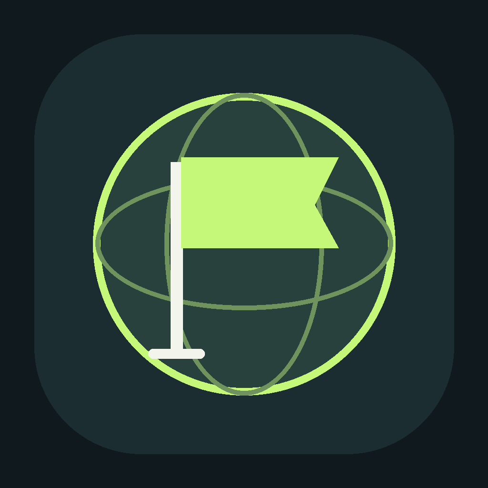

# Flag Game · Atlas

Jogo educativo em **Flutter e Dart** para reconhecer bandeiras de países. Escolha uma região, prepare o cronômetro e tente superar seu recorde. O catálogo com **195 países e suas imagens** acompanha o projeto: nenhuma pergunta depende de uma chamada à internet.

**Atividade 03 — Programação para Dispositivos Móveis**  
**IFPI — Campus Corrente**  
**Aluno: Caio Vieira Vila Nova**



## Escolha seu modo de jogo

O menu começa pela escolha do desafio. Os modos têm interfaces e objetivos diferentes:

| Modo | O que aparece | Como responder |
| --- | --- | --- |
| **Qual é o país?** | Uma bandeira completa | Escolha o nome entre quatro países |
| **Encontre a bandeira** | O nome de um país | Escolha uma das quatro imagens de bandeiras |
| **Bandeira secreta** | Uma bandeira coberta por um mosaico | Reconheça o país à medida que as partes aparecem |

No desafio inverso, os nomes das quatro imagens só aparecem depois da resposta. No mosaico, três das doze partes começam visíveis. A cada 1,5 segundo, mais duas partes são abertas; a bandeira fica totalmente visível em 7,5 segundos. Ao responder, a imagem inteira é revelada para ajudar no aprendizado.

Depois de escolher o modo, configure nome, tempo, dificuldade e continente. A pontuação continua sendo um ponto por acerto em todos os desafios. Cada modo possui seu próprio ranking; resultados e preferências da versão anterior são recuperados como **Qual é o país?**.

## Executar no computador

1. Extraia o ZIP inteiro. Não tente executar arquivos de dentro do ZIP.
2. Abra a pasta `Flag_Game_Atlas` no VS Code. Ela deve conter o arquivo `pubspec.yaml`.
3. Abra o terminal nessa pasta e execute:

```bash
flutter pub get
flutter run -d chrome
```

No Windows também é possível abrir **`iniciar_windows.bat`** depois de extrair o projeto. Ele verifica o Flutter, instala as dependências e inicia o jogo no Chrome. O Flutter deve estar instalado e disponível no PATH. Não é necessário Android Studio para rodar no navegador.

Para conferir o ambiente:

```bash
flutter --version
flutter doctor
flutter devices
```

O projeto aceita **Flutter 3.47.7 ou superior**, com Dart 3.13 ou superior. A validação inicial e a geração dos arquivos nativos foram realizadas com Flutter 3.47.9 / Dart 3.13.7. A compatibilidade também foi conferida com **Flutter 3.47.7 / Dart 3.13.5**, incluindo a instalação das dependências, a análise e os testes automatizados. Dependências são declaradas em `pubspec.yaml` e as versões resolvidas estão em `pubspec.lock`.

Se o terminal não reconhecer `flutter`, confira a instalação e adicione a pasta `bin` do Flutter ao PATH. Se o Chrome não aparecer em `flutter devices`, execute `flutter config --enable-web`. No computador, mantenha o terminal aberto enquanto utiliza `flutter run`.

## O que está implementado

- **Jogo aleatório** com países dos cinco continentes.
- **Jogar por continente:** África, América, Ásia, Europa e Oceania.
- **Tempo total:** 30 segundos, 60 segundos, 3 minutos ou 5 minutos.
- Seleção de três desafios no menu, com explicação e prévia de cada um.
- Bandeira → país, país → bandeira e revelação progressiva em mosaico, sempre com **quatro alternativas diferentes** e uma correta.
- Cronômetro visível, pontuação durante a partida e avanço automático.
- Acerto e erro destacados por cores, ícones e mensagem. O intervalo de feedback dura 0,85 segundo.
- Resultado com perguntas respondidas, acertos, erros, percentual e melhor sequência.
- Botão para voltar ao menu e opção de jogar novamente com a mesma seleção.
- **Ranking local com `shared_preferences`**, incluindo os dez melhores resultados de cada seleção.
- Dificuldades **Fácil** (67 países selecionados) e **Difícil** (todos os 195 países).
- Nome ou apelido e configurações da última partida salvos localmente.
- Revisão das primeiras oito respostas erradas no final.
- Interface em português, responsiva para celular, tablet e computador.
- Animações na bandeira, nas alternativas e no feedback; tela de ajuda e ícone próprio.

## Regras da partida

O tempo escolhido é o tempo **total da partida**, e não um prazo novo para cada pergunta. O relógio continua durante o feedback, a confirmação de saída e a troca de aplicativo. Um `Stopwatch` mede o tempo decorrido; o `Timer` atualiza a tela, sem assumir que cada callback equivale a um segundo exato.

Cada resposta correta acrescenta **um ponto**. Erros não retiram pontos. Enquanto o feedback está na tela, as alternativas ficam bloqueadas. Respostas no instante do encerramento ou depois dele são recusadas. Uma resposta dada antes do prazo conta mesmo se o feedback for interrompido pelo fim do tempo.

O percentual é `acertos / respondidas × 100`. Com nenhuma resposta, o resultado é 0%. A bandeira que ficou sem resposta quando o tempo acabou não entra no total. Sair antes do encerramento descarta a partida.

As bandeiras são embaralhadas em ciclos: todas as bandeiras da seleção aparecem antes que alguma se repita. O primeiro país de um novo ciclo também não repete o último do anterior. As três alternativas incorretas pertencem ao mesmo conjunto de continente e dificuldade da pergunta.

## Ranking e armazenamento

O ranking compara apenas partidas de **mesmo modo de jogo, continente, dificuldade e duração**. Você pode escolher o modo no filtro da tela de ranking. Uma pontuação de cinco minutos não concorre com uma de trinta segundos. A ordenação utiliza:

1. Maior número de acertos.
2. Maior percentual de acertos.
3. Partida mais recente.

São guardados dez resultados por combinação. Cada resultado possui um identificador para evitar salvamento duplicado. O armazenamento pode ser limpo pela tela de ranking, após confirmação. Isso mantém o nome e as configurações.

Não há servidor, login, SQL ou banco de dados remoto. `countries.json` é o catálogo local e `shared_preferences` guarda configurações e pontuações. No navegador, esses dados ficam vinculados ao navegador e à origem do endereço. Limpar os dados do site, trocar de navegador, usar uma janela anônima ou mudar a porta pode criar um ranking separado. No celular, os dados ficam na instalação do aplicativo. Eles não sincronizam entre aparelhos.

## Estrutura e responsabilidades

| Pasta/arquivo | Responsabilidade |
| --- | --- |
| `lib/main.dart` | Inicialização, carregamento, tema e localização em português |
| `lib/models/` | País, continente, configuração, resposta e resultado |
| `lib/services/country_repository.dart` | Leitura e filtragem do JSON |
| `lib/services/local_storage.dart` | Preferências, persistência e ranking |
| `lib/game/quiz_engine.dart` | Sorteio sem repetição imediata e alternativas |
| `lib/game/game_session.dart` | Regras de tempo, respostas, feedback e pontuação |
| `lib/screens/` | Menu, partida, resultado, ranking e ajuda |
| `lib/theme/` | Cores e estilos visuais |
| `lib/widgets/` | Seletor de modos, apresentação da pergunta, mosaico, bandeiras, cartões e globo |
| `assets/data/countries.json` | 195 países com nome, código, continente e dificuldade |
| `assets/flags/` | 195 imagens PNG locais |
| `assets/fonts/` | Fonte Manrope incluída no projeto |
| `test/` | Testes do catálogo, das regras, da persistência e das telas |
| `android/`, `ios/`, `web/`, `windows/` | Projetos de cada plataforma |
| `docs/` | Requisitos, apresentação, fontes, licenças e validação |

O projeto utiliza `Scaffold`, `Text`, botões Material e `Image.asset`. As telas usam **`Navigator`**, com substituição da rota de partida pelo resultado para evitar acumular jogos antigos no histórico. O estado das telas é atualizado com **`setState`**. A lógica do jogo fica separada dos widgets para permitir testes determinísticos.

## Rodar no celular

### Android

É necessário instalar o Android SDK, aceitar as licenças e conectar um aparelho com depuração USB ou abrir um emulador.

```bash
flutter doctor --android-licenses
flutter devices
flutter run -d ID_DO_DISPOSITIVO
```

Para gerar um APK de teste instalável:

```bash
flutter build apk --release
```

Saída: `build/app/outputs/flutter-apk/app-release.apk`. O projeto usa a assinatura de desenvolvimento do modelo Flutter para facilitar o teste acadêmico. A publicação na Play Store exige chave de assinatura própria, configuração de release e conta de desenvolvedor.

### iPhone

A pasta `ios/` está incluída. Para compilar e instalar no iPhone é necessário **macOS com Xcode**, dispositivo/simulador compatível e configuração de assinatura Apple. Não é possível gerar um aplicativo iOS nativo apenas com Windows e Chrome.

### Windows nativo

O navegador é a forma mais simples para apresentar no computador. Para executar como programa Windows, instale as ferramentas de desenvolvimento Desktop com C++ do Visual Studio, confira `flutter doctor` e use `flutter run -d windows`.

## Analisar, testar e compilar para Web

```bash
flutter analyze
flutter test
flutter build web --no-web-resources-cdn
```

O último comando inclui os recursos do renderizador na distribuição, evitando buscar esses recursos em um CDN ao abrir a versão compilada. O diretório `build/web` pode ser servido por uma hospedagem estática. Não abra `index.html` diretamente por `file://`; utilize um servidor HTTP. Exemplo local com Python:

```bash
python -m http.server 8080 --directory build/web
```

Abra `http://localhost:8080`. A primeira instalação de dependências e a primeira compilação precisam de internet. Depois de instalado no celular, o jogo usa seus arquivos locais. Uma versão Web ainda precisa ser disponibilizada/carregada pelo servidor; o projeto não promete disponibilidade offline de uma página nunca carregada.

O workflow em `.github/workflows/flutter.yml` executa análise, testes e compilação Web a cada push ou pull request no GitHub.

## Conferência da atividade

A matriz completa está em [docs/REQUISITOS.md](docs/REQUISITOS.md). As fontes e licenças dos dados estão em [docs/FONTES.md](docs/FONTES.md). O registro dos testes efetivamente executados está em [docs/VALIDACAO.md](docs/VALIDACAO.md).

O modo **Qual é o país?** mantém a experiência de bandeira e nomes solicitada no enunciado. Os desafios **Encontre a bandeira** e **Bandeira secreta** ampliam a proposta. O projeto também implementa dificuldade, ranking e animações. Suporte a inglês/espanhol não foi incluído; a interface é em português.

## Entrega no GitHub e vídeo

Crie um repositório vazio no seu GitHub e envie o conteúdo desta pasta, mantendo `README.md`, `lib`, `assets`, `test`, `pubspec.yaml`, `pubspec.lock` e as pastas de plataforma. O `.gitignore` evita enviar dependências e arquivos temporários. Não envie apenas `main.dart` e não envie `build/` como código-fonte.

Você pode abrir a pasta no VS Code, utilizar **Controle do Código-Fonte → Inicializar Repositório**, fazer o primeiro commit e escolher **Publicar no GitHub**. O ZIP entregue não publica automaticamente um repositório na sua conta.

A atividade também pede um vídeo explicativo. [docs/APRESENTACAO.md](docs/APRESENTACAO.md) contém uma sequência de demonstração e uma explicação dos componentes para ajudar na sua gravação. Depois de publicar o vídeo, adicione o link a este README antes da entrega ao professor.

## Referências

- [Enunciado da Atividade 03](https://github.com/fgsantosti/programacaodispositivosmoveis/blob/b72b04e164bb1d079e8fa7947b44256684c609d8/PDM_Atividade03.ipynb).
- [Flutter](https://docs.flutter.dev/) e [shared_preferences](https://pub.dev/packages/shared_preferences).
- [mledoze/countries](https://github.com/mledoze/countries), [Flagpedia](https://flagpedia.net/) e [FlagCDN](https://flagcdn.com/).

Os READMEs de GeoBandeiras e QFlags foram consultados como referências de trabalhos da disciplina. A implementação, a interface e as regras deste projeto foram desenvolvidas separadamente; código e recursos desses dois trabalhos não foram incorporados.
# AppBandeiras

